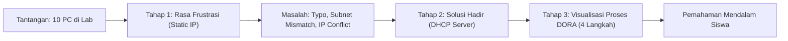
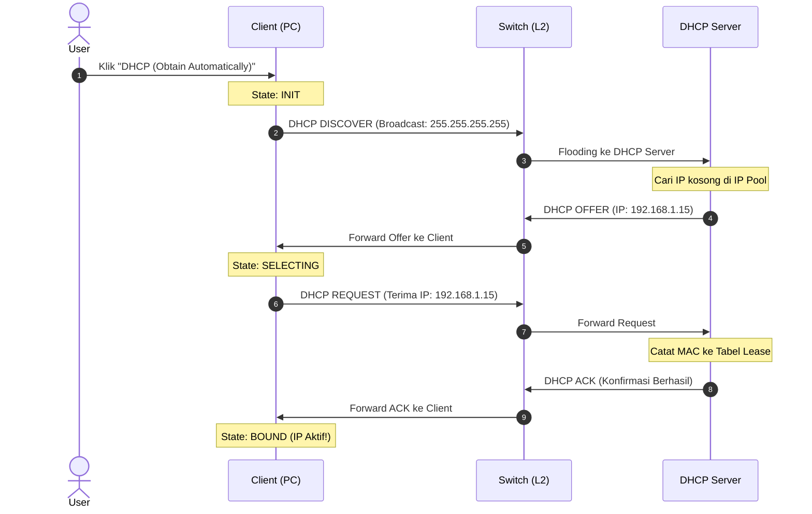

# CETAK BIRU (BLUEPRINT) PERANCANGAN SISTEM
## Aplikasi Simulasi Jaringan Komputer Edukatif: "NetSim DORA"
### Fokus Utama: Pedagogi Pemahaman IP Manual (Static) vs Otomatis (DHCP Server)

---

## DAFTAR ISI
1. [Latar Belakang & Filosofi Pedagogis](#1-latar-belakang--filosofi-pedagogis)
2. [Tujuan & Sasaran Pembelajaran](#2-tujuan--sasaran-pembelajaran)
3. [Arsitektur Sistem & Spesifikasi Teknologi](#3-arsitektur-sistem--spesifikasi-teknologi)
4. [Model Data & Struktur Entitas Jaringan (TypeScript Schema)](#4-model-data--struktur-entitas-jaringan)
5. [Mesin Simulasi Protokol (Protocol Simulation Engine)](#5-mesin-simulasi-protokol)
   - 5.1 Logika Deteksi Konflik IP & Kesalahan Subnet (The Pain)
   - 5.2 Logika Switch L2 (MAC Learning & Flooding)
   - 5.3 Logika DHCP Server & Siklus DORA (The Solution)
   - 5.4 Logika ICMP Ping & Verifikasi Konektivitas
6. [Rancangan Antarmuka Pengguna (UI/UX Blueprint)](#6-rancangan-antarmuka-pengguna-uiux-blueprint)
7. [Mode Pembelajaran Interaktif (Story / Lab Mode)](#7-mode-pembelajaran-interaktif-story--lab-mode)
8. [Struktur Direktori Proyek](#8-struktur-direktori-proyek)
9. [Peta Jalan Implementasi (Sprint Roadmap)](#9-peta-jalan-implementasi-sprint-roadmap)

---

## 1. LATAR BELAKANG & FILOSOFI PEDAGOGIS

Dalam pengajaran jaringan komputer (khususnya tingkat SMK TKJ, Politeknik, dan Universitas), konsep **DHCP (Dynamic Host Configuration Protocol)** sering diajarkan secara instan: *"Buka menu DHCP, klik Enable, lalu di PC centang DHCP"*. 

Pendekatan ini memiliki kelemahan mendasar: **siswa tidak memahami urgensi dan latar belakang terciptanya DHCP**. Tanpa merasakan rumitnya konfigurasi manual (Static IP), siswa tidak memiliki apresiasi mendalam mengenai:
1. Skalabilitas jaringan (bagaimana mengelola ratusan perangkat).
2. Human error (salah ketik subnet mask, salah gateway).
3. Risiko tabrakan alamat (*IP Address Conflict*).
4. Bagaimana protokol DORA sebenarnya bekerja di bawah permukaan kabel.

### Prinsip Desain Edukatif: "Pain $\rightarrow$ Hero $\rightarrow$ Insight"


---

## 2. TUJUAN & SASARAN PEMBELAJARAN

Aplikasi simulator ini dirancang untuk mencapai indikator kompetensi berikut:
* **Kognitif**:
  * Menjelaskan fungsi IP Address, Subnet Mask, Default Gateway, dan DNS.
  * Menguraikan penyebab dan dampak terjadinya *IP Conflict*.
  * Mengurutkan dan menerangkan 4 fase DORA (*Discover, Offer, Request, Acknowledge*).
* **Psikomotorik**:
  * Melakukan konfigurasi IPv4 statis pada workstation.
  * Melakukan instalasi dan konfigurasi scope IP pool pada DHCP Server.
  * Melakukan pengujian konektivitas menggunakan utilitas `ping` dan verifikasi dengan `ipconfig`.
* **Afektif**:
  * Menumbuhkan ketelitian dalam perancangan topologi jaringan.

---

## 3. ARSITEKTUR SISTEM & SPESIFIKASI TEKNOLOGI

Aplikasi dibangun sebagai **Single Page Application (SPA)** murni *client-side*, memastikan aplikasi dapat berjalan cepat, tanpa ketergantungan koneksi internet berat, dan dapat di-host di mana saja atau dijalankan secara lokal di lab komputer.

```
+-------------------------------------------------------------------+
|                        PRESENTATION LAYER                         |
|  [ React Flow Canvas ]   [ Device Modals ]   [ Packet Inspector ] |
|  [ Story Mission HUD ]   [ Audio FX Beeps ]  [ Terminal / CLI ]   |
+-------------------------------------------------------------------+
                                 |
+-------------------------------------------------------------------+
|                     STATE MANAGEMENT (Zustand)                    |
|  - Topology State (Nodes, Edges)                                  |
|  - Network Table (ARP, MAC Tables, DHCP Leases)                   |
|  - Simulation Clock & Event Bus                                   |
+-------------------------------------------------------------------+
                                 |
+-------------------------------------------------------------------+
|                   CORE NETWORK ENGINE (TypeScript)                |
|  [ IP & Subnet Math ] [ DORA State Machine ] [ Packet Dispatcher ]|
|  [ Conflict Monitor ] [ Switch MAC Learner ] [ ICMP Ping Runner ] |
+-------------------------------------------------------------------+
```

### Tumpukan Teknologi Terpilih:
* **Framework Dasar**: React 18+ dengan **TypeScript** (type safety untuk paket dan entitas jaringan).
* **Build System**: **Vite** (eksekusi super cepat, reload instan).
* **Canvas & Wiring Engine**: **`@xyflow/react` (React Flow v12)**:
  * Drag-and-drop node tanpa batas.
  * Custom animated edges untuk pergerakan amplop paket.
  * Port snapping (koneksi antar port interface `eth0`, `Fa0/1`).
* **State Management**: **Zustand** (reaktif, performa tinggi saat terjadi ratusan event frame per detik).
* **Desain & Gaya**: Custom Modern CSS / CSS Modules dengan variabel desain terpusat (Sleek Dark Cyber Lab / Edu Clean Mode).
* **Ikonografi**: **Lucide React** (`Monitor`, `Server`, `Network`, `HardDrive`, `Terminal`, `Radio`).
* **Sound Engine**: **Web Audio API** (Sintesis suara procedural tanpa file audio eksternal untuk bunyi klik, peringatan konflik, dan konfirmasi sukses).

---

## 4. MODEL DATA & STRUKTUR ENTITAS JARINGAN

### 4.1 Entitas Perangkat (`DeviceNode`)
```typescript
export type DeviceType = 'PC' | 'LAPTOP' | 'SWITCH' | 'ROUTER' | 'SERVER';

export interface NetworkInterface {
  id: string;              // e.g. "eth0", "Fa0/1"
  name: string;
  macAddress: string;      // Format "00:1A:2B:3C:4D:5E"
  ipAssignment: 'STATIC' | 'DHCP';
  ipAddress: string | null;     // e.g. "192.168.1.10"
  subnetMask: string | null;    // e.g. "255.255.255.0"
  defaultGateway: string | null;// e.g. "192.168.1.1"
  dnsServer: string | null;     // e.g. "8.8.8.8"
  linkStatus: 'UP' | 'DOWN';
  connectedToDeviceId?: string;
  connectedToInterfaceId?: string;
}

export interface DeviceData {
  id: string;
  label: string;
  type: DeviceType;
  interfaces: NetworkInterface[];
  arpTable: Map<string, string>; // IP -> MAC
  
  // Khusus Switch (L2)
  macTable?: Map<string, string>; // MAC -> PortInterfaceId

  // Khusus Server (L7 Service)
  dhcpConfig?: {
    enabled: boolean;
    poolNetwork: string;       // "192.168.1.0"
    subnetMask: string;        // "255.255.255.0"
    startIp: string;           // "192.168.1.10"
    endIp: string;             // "192.168.1.100"
    defaultGateway: string;    // "192.168.1.1"
    dnsServer: string;         // "192.168.1.1"
    leaseTimeSeconds: number;  // 86400
    leases: Array<{
      mac: string;
      ip: string;
      expiresAt: number;
    }>;
  };
}
```

### 4.2 Struktur Paket Data (`NetworkPacket`)
```typescript
export type PacketType = 
  | 'ARP_REQUEST' | 'ARP_REPLY'
  | 'DHCP_DISCOVER' | 'DHCP_OFFER' | 'DHCP_REQUEST' | 'DHCP_ACK'
  | 'ICMP_ECHO_REQUEST' | 'ICMP_ECHO_REPLY';

export interface NetworkPacket {
  id: string;
  type: PacketType;
  sourceDeviceId: string;
  sourceInterfaceId: string;
  targetDeviceId?: string;      // Kosong jika broadcast
  targetInterfaceId?: string;
  
  layer2: {
    srcMac: string;
    dstMac: string;            // "FF:FF:FF:FF:FF:FF" untuk broadcast
  };
  
  layer3: {
    srcIp: string;             // "0.0.0.0" saat DORA Discover
    dstIp: string;             // "255.255.255.255" saat DORA Discover
  };
  
  payload: {
    transactionId?: string;
    offeredIp?: string;
    requestedIp?: string;
    pingSeq?: number;
    message?: string;
  };
  
  animation: {
    currentEdgeId: string;
    progress: number; // 0 to 1
    color: string;
  };
}
```

---

## 5. MESIN SIMULASI PROTOKOL

### 5.1 Logika Deteksi Konflik IP & Kesalahan Subnet (The Pain)
Sistem memonitor perubahan konfigurasi statis:
1. **Validasi Subnet**:
   * Jika PC A (`192.168.1.2 / 24`) mencoba ping PC B (`192.168.2.2 / 24`) tanpa router $\rightarrow$ Sistem menghasilkan status: `"Destination Host Unreachable (Different Subnet without Gateway)"`.
2. **Deteksi IP Conflict**:
   * Saat user memasukkan IP yang sudah digunakan perangkat lain di broadcast domain yang sama:
     * Menghasilkan **Gratuitous ARP Conflict**.
     * Menampilkan popup peringatan visual: *"⚠️ IP Address Conflict! 192.168.1.2 sudah digunakan oleh PC-01"*.
     * Port pada perangkat kedua berubah menjadi **Orange/Red Error Indicator**.

### 5.2 Logika Switch L2 (MAC Learning & Flooding)
* Saat frame masuk ke Port X dari Switch:
  1. Switch membaca `srcMac` dan menyimpannya di `macTable`: `[srcMac] -> Port X`.
  2. Switch membaca `dstMac`:
     * Jika `dstMac == "FF:FF:FF:FF:FF:FF"` (Broadcast): Switch menduplikasi paket ke seluruh port aktif kecuali Port X (*Flooding*).
     * Jika `dstMac` sudah ada di `macTable`: Kirim paket hanya ke port yang terdaftar (*Unicast*).
     * Jika belum ada di tabel: Lakukan *Flooding* ke semua port.

### 5.3 Logika DHCP Server & Siklus DORA (The Solution)
Visualisasi animasi 4 tahap dengan jeda waktu yang dapat disesuaikan (default: 1 detik per fase):



* **Warna Amplop Paket DORA**:
  * 🟡 **Discover**: Kuning cerah (mencari server).
  * 🔵 **Offer**: Biru laut (penawaran alamat).
  * 🟣 **Request**: Ungu (persetujuan client).
  * 🟢 **Acknowledge**: Hijau neon (kesepakatan sukses).

---

## 6. RANCANGAN ANTARMUKA PENGGUNA (UI/UX BLUEPRINT)

```
+-----------------------------------------------------------------------------------+
|  [NetSim DORA]  | Mode: [●] Sandbox  [○] Skenario Lab | Kecepatan: [1.0x v] | [🔊 Sound] |
+-----------------------------------------------------------------------------------+
| PALETTE     |                            TOPOLOGY CANVAS                          |
|             |                                                                     |
| [🖥️ PC]     |        [ PC-01 ] ---(Kuning: DORA Discover)---> [ Switch 8-Port ]   |
| [💻 Laptop] |          (192.168.1.2)                                    |         |
| [🔲 Switch] |                                                           |         |
| [🖧 Router] |        [ PC-02 ] -----------------------------------------+         |
| [🗄️ Server] |       (IP Conflict!)                                      |         |
|             |                                                           |         |
| [🔌 Kabel]  |                                                     [ Server DHCP ] |
|             |                                                     (192.168.1.1)   |
+-------------+---------------------------------------------------------------------+
| PACKET INSPECTOR & TIMELINE                                                       |
| [▶ Play] [⏸ Pause] [⏮ Step] | Paket Aktif: DHCP_DISCOVER | Src: 0.0.0.0 Dst: 255.255.255.255|
+-----------------------------------------------------------------------------------+
```

### Jendela Dialog Perangkat (Device Modal)
Ketika node diklik dua kali (*double click*):
1. **Modal PC / Laptop**:
   * **Tab Desktop $\rightarrow$ IP Configuration**:
     * Radio Button: `( ) Static` | `(●) DHCP`
     * Input Field: `IP Address`, `Subnet Mask`, `Default Gateway`, `DNS Server`.
     * Tombol: `[ Request DHCP Now ]`.
   * **Tab Command Prompt**:
     * Mendukung command:
       * `ipconfig` / `ipconfig /all` $\rightarrow$ menampilkan IP & MAC.
       * `ping <IP_Tujuan>` $\rightarrow$ visual animasi ping + teks output `Reply from ... time=2ms TTL=64`.
       * `arp -a` $\rightarrow$ melihat tabel ARP lokal.
2. **Modal DHCP Server**:
   * **Tab Services $\rightarrow$ DHCP**:
     * Toggle Switch: `Service Status: [ ON | OFF ]`
     * Input: `Default Gateway`, `DNS Server`.
     * Input Range: `Start IP Address` (misal: `192.168.1.10`) & `Maximum Number of Users` (misal: `50`).
     * **Tabel DHCP Client Lease**: Menampilkan daftar dinamis perangkat yang sudah meminjam IP (Host Name, MAC Address, Assigned IP, Lease Time).

---

## 7. MODE PEMBELAJARAN INTERAKTIF (STORY / LAB MODE)

Untuk memfasilitasi pengajaran di kelas, aplikasi menyediakan **Guided Missions**:

### Misi 1: "Frustrasi di Lab Baru"
* **Instruksi**: *"Ada 5 komputer baru di lab sekolah. Sambungkan semuanya ke Switch dan berikan IP secara manual agar semua PC bisa saling ping."*
* **Tantangan Terselubung**: Siswa diminta memasukkan IP satu per satu. Pada PC ke-4, sistem sengaja meminta siswa mengecek kemungkinan IP tabrakan.
* **Refleksi**: Di akhir misi, aplikasi memunculkan dialog: *"Berapa lama Anda menghabiskan waktu? Bagaimana jika ada 200 komputer?"*

### Misi 2: "Hadirnya DHCP Server"
* **Instruksi**: *"Sekolah membeli 1 Server baru. Pasang server ke switch, aktifkan layanan DHCP, lalu ubah mode IP semua PC menjadi DHCP!"*
* **Efek Wow**: Sekali klik tombol DHCP di tiap PC, paket warna-warni meluncur dan IP langsung terisi otomatis.

### Misi 3: "Mengintip Rahasia DORA"
* **Instruksi**: *"Gunakan fitur Step-by-Step pada Packet Inspector untuk melihat isi paket Discover, Offer, Request, dan Acknowledge."*

---

## 8. STRUKTUR DIREKTORI PROYEK

```
netsim-dora/
├── index.html
├── package.json
├── tsconfig.json
├── vite.config.ts
├── public/
│   ├── favicon.ico
│   └── sounds/                 # Cadangan audio sintetis
└── src/
    ├── main.tsx
    ├── App.tsx
    ├── App.css
    ├── assets/
    ├── types/
    │   ├── network.ts          # Definisi tipe Device, Interface, Packet, DHCP
    │   └── missions.ts         # Tipe data skenario misi lab
    ├── core/
    │   ├── ipEngine.ts         # Kalkulasi subnet, validasi IP, deteksi konflik
    │   ├── dhcpEngine.ts       # Logic DORA & IP pool allocation
    │   ├── switchEngine.ts     # MAC table & packet forwarding
    │   └── soundEngine.ts      # Web Audio API sintetis (beep, chime, warning)
    ├── store/
    │   ├── useNetworkStore.ts  # State global topology & packet queue
    │   └── useMissionStore.ts  # State progres misi pembelajaran
    ├── components/
    │   ├── Header/             # Navbar kontrol (Play/Pause/Speed/Missions)
    │   ├── Sidebar/            # Palette device drag-and-drop
    │   ├── Canvas/
    │   │   ├── NetworkCanvas.tsx
    │   │   ├── nodes/
    │   │   │   ├── PCNode.tsx
    │   │   │   ├── SwitchNode.tsx
    │   │   └── edges/
    │   │       └── AnimatedCable.tsx # Kabel animasi paket amplop
    │   ├── Modals/
    │   │   ├── DeviceModal.tsx
    │   │   ├── tabs/
    │   │   │   ├── IPConfigTab.tsx
    │   │   │   ├── CommandPromptTab.tsx
    │   │   │   └── DHCPServerTab.tsx
    │   ├── PacketInspector/    # Panel bawah analisis paket L2/L3
    │   └── MissionHUD/         # Petunjuk langkah misi interaktif
    └── utils/
        └── macGenerator.ts     # Generator MAC address otomatis
```

---

## 9. PETA JALAN IMPLEMENTASI (SPRINT ROADMAP)

| Tahap | Fokus Utama | Target Luaran |
| :--- | :--- | :--- |
| **Sprint 1** | Inisialisasi & Topology Canvas | • Canvas React Flow dengan node PC, Switch, Server.<br>• Fitur tarik kabel koneksi port.<br>• Palette drag-and-drop perangkat. |
| **Sprint 2** | UI Konfigurasi Perangkat | • Modal PC: input Static IP, Subnet Mask, Gateway.<br>• Modal Server: form konfigurasi DHCP IP Pool & ON/OFF switch.<br>• Terminal CLI mini (`ipconfig`). |
| **Sprint 3** | Mesin Deteksi Konflik & Error Subnet | • Logika validasi subnetting.<br>• Deteksi otomatis *IP Conflict* dengan alert visual dan audio buzzer. |
| **Sprint 4** | Engine Animasi Siklus DORA | • Transmisi paket 4 tahap (Discover $\rightarrow$ Offer $\rightarrow$ Request $\rightarrow$ ACK).<br>• Animasi amplop warna-warni meluncur di atas kabel.<br>• Mode otomatis *Obtain IP* berhasil pada PC client. |
| **Sprint 5** | Packet Inspector & Story Mode | • Panel timeline paket (Play, Pause, Step-by-Step).<br>• Mode Misi Lab Interaktif 1, 2, dan 3.<br>• Polish visual, sound effect Web Audio, dan optimasi performa. |

---

*Cetak biru ini dirancang sebagai acuan arsitektur dan teknis resmi dalam pembuatan simulator jaringan komputer NetSim DORA.*
