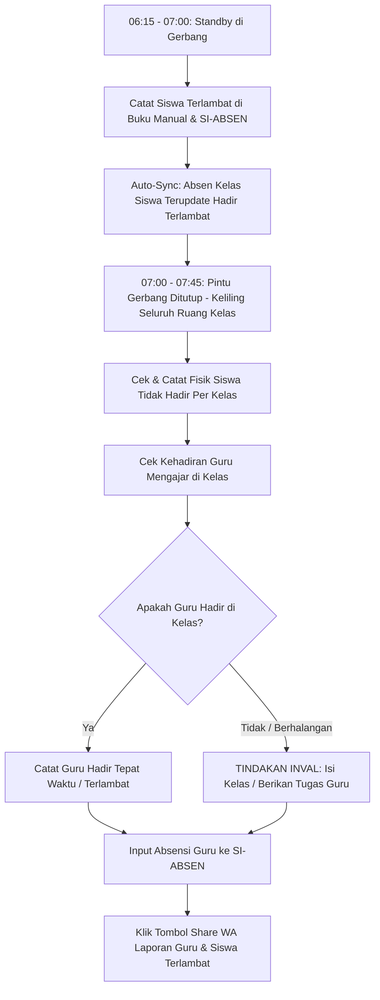

# 📖 Panduan Penggunaan Lengkap SI-ABSEN
### Sistem Informasi Presensi & Pembinaan Siswa — SMK 11 Maret (Bekasi & Jakarta)

Dokumen ini memuat petunjuk operasional dan panduan lengkap penggunaan seluruh fitur aplikasi **SI-ABSEN** untuk semua peran (*role*) pada lingkungan sekolah **SMK 11 Maret** (Cabang Bekasi dan Cabang Jakarta).

---

## 📑 Daftar Isi
1. [Sekilas Aplikasi & Dua Cabang Sekolah (Bekasi & Jakarta)](#1-sekilas-aplikasi--dua-cabang-sekolah-bekasi--jakarta)
2. [Matriks Peran & Hak Akses Pengguna](#2-matriks-peran--hak-akses-pengguna)
3. [Panduan Role: Administrator (Admin)](#3-panduan-role-administrator-admin)
   - [3.1 Dashboard & Statistik Global](#31-dashboard--statistik-global)
   - [3.2 Master Data Guru & Import Excel](#32-master-data-guru--import-excel)
   - [3.3 Master Data Kelas & Wali Kelas](#33-master-data-kelas--wali-kelas)
   - [3.4 Master Data Siswa, Gender L/P & Status Mutasi](#34-master-data-siswa-gender-lp--status-mutasi)
   - [3.5 Manajemen Pengguna & Reset Password](#35-manajemen-pengguna--reset-password)
   - [3.6 Penugasan Guru Piket & Jadwal Mengajar](#36-penugasan-guru-piket--jadwal-mengajar)
   - [3.7 Kalender Pendidikan & Hari Libur](#37-kalender-pendidikan--hari-libur)
   - [3.8 Monitoring Keterlambatan Guru & Jam Masuk](#38-monitoring-keterlambatan-guru--jam-masuk)
   - [3.9 Laporan Presensi Hierarkis (Drill-Down) & Export Excel](#39-laporan-presensi-hierarkis-drill-down--export-excel)
   - [3.10 Monitoring Persentase Kehadiran Guru & Siswa](#310-monitoring-persentase-kehadiran-guru--siswa)
   - [3.11 Riwayat Pembinaan Siswa (Kasus Perilaku/SP)](#311-riwayat-pembinaan-siswa-kasus-perilakusp)
   - [3.12 Evaluasi Rombel Rapat Akhir Semester](#312-evaluasi-rombel-rapat-akhir-semester)
4. [Panduan Role: Wali Kelas (Walas)](#4-panduan-role-wali-kelas-walas)
   - [4.1 Dashboard Wali Kelas & Filter Rentang Tanggal](#41-dashboard-wali-kelas--filter-rentang-tanggal)
   - [4.2 Input & Koreksi Presensi Harian Siswa](#42-input--koreksi-presensi-harian-siswa)
   - [4.3 Fitur Tandai Libur / Acara Khusus Kelas](#43-fitur-tandai-libur--acara-khusus-kelas)
   - [4.4 Rekap Kehadiran Kelas & Export Excel](#44-rekap-kehadiran-kelas--export-excel)
   - [4.5 Laporan & Riwayat Keterlambatan Siswa Kelas](#45-laporan--riwayat-keterlambatan-siswa-kelas)
   - [4.6 Pencatatan Kasus & Pembinaan Siswa Binaan](#46-pencatatan-kasus--pembinaan-siswa-binaan)
   - [4.7 Evaluasi Rombel Semester (Dinamika L/P & Mutasi)](#47-evaluasi-rombel-semester-dinamika-lp--mutasi)
   - [4.8 Manajemen Siswa Kelas (Nonaktif/Mutasi & Gender)](#48-manajemen-siswa-kelas-nonaktifmutasi--gender)
   - [4.9 Manajemen Akun Perwakilan Kelas (PJ Kelas)](#49-manajemen-akun-perwakilan-kelas-pj-kelas)
5. [Panduan Role: Guru Piket (guru_piket)](#5-panduan-role-guru-piket-guru_piket)
   - [5.1 Peran Utama, SOP Pencatatan Manual & Digital](#51-peran-utama-sop-pencatatan-manual--digital)
   - [5.2 Tahap 1: Pencatatan Siswa Terlambat di Gerbang & Auto-Sinkron](#52-tahap-1-pencatatan-siswa-terlambat-di-gerbang--auto-sinkron)
   - [5.3 Tahap 2: Keliling Kelas & Cek Fisik Ketidakhadiran Siswa](#53-tahap-2-keliling-kelas--cek-fisik-ketidakhadiran-siswa)
   - [5.4 Tahap 3: Absensi Kehadiran Guru Mengajar di Kelas](#54-tahap-3-absensi-kehadiran-guru-mengajar-di-kelas)
   - [5.5 Tahap 4: Penanganan Kelas Kosong (Inval / Memberikan Tugas)](#55-tahap-4-penanganan-kelas-kosong-inval--memberikan-tugas)
   - [5.6 Tahap 5: Rekapitulasi & Share Laporan WhatsApp Grup](#56-tahap-5-rekapitulasi--share-laporan-whatsapp-grup)
6. [Panduan Role: Penanggung Jawab Kelas (pj_kelas)](#6-panduan-role-penanggung-jawab-kelas-pj_kelas)
   - [6.1 Dashboard & Login PJ Kelas](#61-dashboard--login-pj-kelas)
   - [6.2 Pengisian Presensi Rekan Sekelas](#62-pengisian-presensi-rekan-sekelas)
   - [6.3 Upload Foto Suasana Belajar di Kelas](#63-upload-foto-suasana-belajar-di-kelas)
   - [6.4 Laporan WhatsApp Otomatis ke Grup Orang Tua](#64-laporan-whatsapp-otomatis-ke-grup-orang-tua)
7. [Panduan Akses Publik: Live Presensi Orang Tua Murid](#7-panduan-akses-publik-live-presensi-orang-tua-murid)
8. [Standar Operasional Prosedur (SOP) Rutin Harian Sekolah](#8-standar-operasional-prosedur-sop-rutin-harian-sekolah)
9. [Tanya Jawab & Pemecahan Masalah (FAQ)](#9-tanya-jawab--pemecahan-masalah-faq)

---

## 1. Sekilas Aplikasi & Dua Cabang Sekolah (Bekasi & Jakarta)

**SI-ABSEN** adalah platform terintegrasi untuk pencatatan presensi siswa, absensi kedatangan guru, pemantauan ketertiban/keterlambatan gerbang, kontrol KBM kelas kosong, pembinaan kesiswaan, hingga evaluasi rombel rapat akhir semester pada **SMK 11 Maret**.

SMK 11 Maret menaungi **2 Cabang Kampus** yang masing-masing memiliki identitas domain dan tema visual:

| Cabang Sekolah | Alamat Domain / Subdomain | Skema Warna & Tema | Badge & Keterangan |
|---|---|---|---|
| **SMK 11 Maret Cabang Bekasi** | `https://presensi.smk11maret.id/` | **Hijau Tua (Dark Emerald `#10b981`)** | Khas almamater hijau SMK 11 Maret Bekasi |
| **SMK 11 Maret Cabang Jakarta** | `https://osis.smk11maret.id/` | **Modern Indigo / Navy Blue (`#6366f1`)** | Khas almamater biru SMK 11 Maret Jakarta |

> [!NOTE]
> Sistem secara otomatis menyesuaikan warna tema, judul halaman, dan identitas badge sekolah berdasarkan domain yang dibuka. Seluruh database, hak akses, dan fitur tetap terintegrasi secara andal.

---

## 2. Matriks Peran & Hak Akses Pengguna

| Fitur / Modul | Admin | Wali Kelas | Guru Piket | PJ Kelas | Orang Tua (Publik) |
|---|:---:|:---:|:---:|:---:|:---:|
| Kelola Master Guru, Kelas, & Users | ✅ | ❌ | ❌ | ❌ | ❌ |
| Kelola Siswa, Mutasi, & Gender L/P | ✅ | ✅ (Kelas Sendiri) | ❌ | ❌ | ❌ |
| Jadwal Mengajar & Penugasan Piket | ✅ | ❌ | ❌ | ❌ | ❌ |
| Kalender Pendidikan (Libur Sekolah) | ✅ | ❌ | ❌ | ❌ | ❌ |
| Absensi Guru per Shift (Pagi/Siang) | ✅ | ❌ | ✅ | ❌ | ❌ |
| Catat Siswa Terlambat di Gerbang | ✅ | ❌ | ✅ | ❌ | ❌ |
| Input Presensi Harian Siswa | ✅ | ✅ | ❌ | ✅ | ❌ |
| Upload Foto Suasana Belajar Kelas | ❌ | ✅ | ❌ | ✅ | ❌ |
| Rekap Laporan & Export Excel Kelas | ✅ | ✅ | ❌ | ✅ (Lihat) | ❌ |
| Catat Kasus & Pembinaan Siswa | ✅ | ✅ | ❌ | ❌ | ❌ |
| Rapat Evaluasi Rombel Akhir Semester | ✅ (Semua Kelas) | ✅ (Kelas Sendiri) | ❌ | ❌ | ❌ |
| Live Presensi Real-Time & Foto Kelas | ✅ | ✅ | ✅ | ✅ | ✅ (Via Link/QR) |

---

## 3. Panduan Role: Administrator (Admin)

Administrator memegang kendali penuh atas konfigurasi sistem, data induk master, kalender pendidikan, dan rekapitulasi sekolah secara komprehensif.

### 3.1 Dashboard & Statistik Global
- **Akses**: Menu `Dashboard` atau URL `/admin`.
- **Informasi yang Ditampilkan**:
  - Total Guru, Total Kelas, Total Siswa Aktif, dan Persentase Rata-rata Kehadiran Sekolah.
  - Kartu Ringkasan Hari Ini: Siswa Hadir, Sakit, Izin, Alpa, Terlambat.
  - Grafik tren kehadiran mingguan/bulanan.
  - Daftar kelas dengan tingkat kehadiran terendah (indikator perhatian khusus).

### 3.2 Master Data Guru & Import Excel
- **Akses**: Menu `Data Master` ➔ `Data Guru` (`/admin/guru`).
- **Tambah Guru Manual**:
  1. Klik tombol **Tambah Guru**.
  2. Isi NIP, Nama Lengkap beserta gelar, dan Nomor WhatsApp aktif.
  3. Klik **Simpan**.
- **Import Guru Massal**:
  1. Klik tombol **Download Template Excel Guru**.
  2. Isi kolom NIP, Nama Guru, dan No HP pada file `.xlsx` yang diunduh.
  3. Klik **Import Excel**, pilih berkas Anda, lalu klik **Upload & Proses**.

### 3.3 Master Data Kelas & Wali Kelas
- **Akses**: Menu `Data Master` ➔ `Data Kelas` (`/admin/kelas`).
- **Kelola Rombel**:
  1. Tambah nama rombel (contoh: `X TKJ 1`, `XI AKL 2`, `XII BDP 1`).
  2. Tentukan **Shift Belajar**:
     - **Pagi**: Jam masuk pukul `06:30` / `07:00`.
     - **Siang**: Jam masuk pukul `12:30`.
  3. Pilih **Wali Kelas** penanggung jawab dari daftar guru yang terdaftar.
  4. Klik **Simpan**.

### 3.4 Master Data Siswa, Gender L/P & Status Mutasi
- **Akses**: Menu `Data Master` ➔ `Data Siswa` (`/admin/siswa`).
- **Kelola Profil & Gender Siswa**:
  - Terdapat indikator badge jenis kelamin: **L (Laki-laki)** berwarna biru, **P (Perempuan)** berwarna pink.
- **Fitur Deteksi Otomatis Gender L/P (`Auto-Detect`)**:
  1. Jika banyak data siswa belum memiliki gender, klik tombol **⚡ Deteksi Otomatis Gender (L/P)**.
  2. Sistem berbasis kecerdasan kata nama siswa (misal: Muhammad, Putri, Siti, Bagas, Rizky, Dewi) akan otomatis menebak jenis kelamin.
  3. Muncul modal verifikasi tabel hasil deteksi.
  4. Anda dapat mengoreksi tebakan jika ada yang keliru, lalu klik **Simpan Semua Gender**.
- **Edit Batch Gender**: Memungkinkan pemilihan cepat jenis kelamin per baris tanpa harus membuka form edit satu per satu.
- **Status Keaktifan & Mutasi**:
  - Siswa yang keluar, pindah sekolah, atau mengundurkan diri dapat diubah statusnya menjadi **Non-Aktif / Mutasi** dengan mengklik tombol status atau tombol **Keluarkan/Mutasi**.
  - Masukkan alasan (Pindah Sekolah, Mengundurkan Diri, Dikeluarkan/DO, Lainnya), tanggal mutasi, dan catatan nomor surat/berkas.

### 3.5 Manajemen Pengguna & Reset Password
- **Akses**: Menu `Pengaturan` ➔ `Manajemen Pengguna` (`/admin/users`).
- **Fungsi**:
  - Membuat akun baru untuk Admin, Wali Kelas, atau Guru Piket.
  - Reset password pengguna jika guru atau wali kelas lupa kata sandi. Password default setelah reset adalah `12345678` (pengguna akan diwajibkan mengganti password pada login pertama).

### 3.6 Penugasan Guru Piket & Jadwal Mengajar
- **Jadwal Guru Mengajar** (`/admin/jadwal-guru`):
  - Mengatur jadwal mengajar setiap guru berdasarkan Hari (Senin–Sabtu) dan Shift (Pagi/Siang).
  - Data jadwal ini menjadi acuan daftar wajib hadir pada modul absensi Guru Piket.
- **Penugasan Guru Piket** (`/admin/penugasan-piket`):
  - Menugaskan guru-guru yang berjaga piket pada hari tertentu.

### 3.7 Kalender Pendidikan & Hari Libur
- **Akses**: Menu `Akademik` ➔ `Kalender Pendidikan` (`/admin/kalender-pendidikan`).
- **Fungsi**:
  - Mendaftarkan hari libur nasional, libur cuti bersama, atau agenda sekolah khusus.
  - **Dampak Sistem**: Tanggal yang ditandai libur otomatis **tidak dihitung sebagai alpa/kekurangan hari efektif** pada rekapitulasi persentase kehadiran bulanan dan semester.

### 3.8 Monitoring Keterlambatan Guru & Jam Masuk
- **Akses**: Menu `Guru` ➔ `Keterlambatan Guru` (`/admin/keterlambatan-guru`).
- **Konfigurasi Jam Masuk**:
  - Atur jam masuk resmi Shift Pagi (default `06:30`) dan Shift Siang (default `12:30`) beserta toleransi menit.
- **Rekap Keterlambatan**:
  - Melihat akumulasi keterlambatan guru dalam hitungan menit dan frekuensi kejadian.
  - Dilengkapi tombol **Export Excel Keterlambatan Guru**.

### 3.9 Laporan Presensi Hierarkis (Drill-Down) & Export Excel
- **Akses**: Menu `Laporan` ➔ `Laporan Presensi` (`/admin/laporan`).
- **Fitur Drill-Down 3 Tingkat**:
  1. **Tingkat 1 (Global Sekolah)**: Menampilkan rekapitulasi total per kelas (H, S, I, A, P, % Kehadiran). Terdapat tombol **Export Global Excel**.
  2. **Tingkat 2 (Per Rombel Kelas)**: Klik nama kelas untuk melihat daftar seluruh siswa di kelas tersebut beserta rincian jumlah ketidakhadiran. Terdapat tombol **Export Kelas Excel**.
  3. **Tingkat 3 (Per Siswa)**: Klik nama siswa untuk memeriksa buku catatan presensi detail siswa tersebut tanggal demi tanggal lengkap dengan status dan keterangannya. Terdapat tombol **Export Siswa Excel**.
- **Filter Fleksibel**: Dapat disaring berdasarkan tanggal tunggal, bulan, atau rentang tanggal custom (contoh: 1 semester penuh).

### 3.10 Monitoring Persentase Kehadiran Guru & Siswa
- **Akses**: Menu `Monitoring` (`/admin/monitoring`).
- Menampilkan perbandingan persentase performa kehadiran guru vs kehadiran siswa dengan grafik interaktif dan export Excel.

### 3.11 Riwayat Pembinaan Siswa (Kasus Perilaku/SP)
- **Akses**: Menu `Kesiswaan` ➔ `Riwayat Pembinaan` (`/admin/pembinaan`).
- **Pencatatan Pelanggaran Siswa**:
  - Mencatat siswa bermasalah: perkelahian/berantem, merokok, bolos, pornografi, perundungan (*bullying*), dll.
  - Memilih **Tindakan Sekolah**: Peringatan Lisan, Surat Teguran, Panggilan Orang Tua, Surat Peringatan (SP 1, SP 2, SP 3), hingga Skorsing.
  - Mengunggah berkas bukti atau foto surat panggilan jika diperlukan.

### 3.12 Evaluasi Rombel Rapat Akhir Semester
- **Akses**: Menu `Laporan` ➔ `Evaluasi Semester` (`/admin/evaluasi-semester`).
- **Kegunaan Khusus**: Modul resmi untuk pembahasan rapat pleno kenaikan kelas / kelulusan di akhir semester.
- **Data yang Dihasilkan**:
  1. **Dinamika Jumlah Siswa**: Jumlah awal semester (Laki-laki, Perempuan, Total) vs Jumlah siswa keluar/mutasi vs Jumlah aktif akhir semester.
  2. **Identifikasi Siswa Bermasalah**:
     - Filter threshold batas minimal: Siswa dengan Alpa $\ge X$, Keterlambatan $\ge Y$, atau Kasus Pembinaan/SP $\ge Z$.
     - Menampilkan rincian kasus pelanggaran (tanggal, jenis tindakan, catatan kasus).
  3. **Export Excel Rapat Semester (2 Sheet Resmi)**:
     - **Sheet 1**: Ringkasan Eksekutif Dinamika Rombel per Kelas (Komposisi Awal L/P, Mutasi, dan Komposisi Akhir).
     - **Sheet 2**: Rekap Detail Siswa Bermasalah (Alpa, Terlambat, Riwayat SP, Rincian Kasus Perilaku, dan Kolom Catatan Keputusan Rapat Pleno).

---

## 4. Panduan Role: Wali Kelas (Walas)

Wali Kelas memiliki tanggung jawab utama terhadap absensi harian kelas binaannya, verifikasi catatan keterlambatan, pembinaan siswa, dan pertanggungjawaban rombel pada rapat evaluasi semester.

### 4.1 Dashboard Wali Kelas & Filter Rentang Tanggal
- **Akses**: Menu `Dashboard` (`/walas`).
- **Fitur Baru (Filter Rentang Tanggal Kustom)**:
  - Walas dapat memilih rentang tanggal bebas: **Dari Tanggal s/d Sampai Tanggal** (misal: 1 Juli s/d 20 Desember).
  - Ringkasan kartu statistik (Hadir, Sakit, Izin, Alpa, Terlambat) dan grafik tren otomatis menyesuaikan dengan periode tanggal yang dipilih.
- **Alert Otomatis Siswa Butuh Pembinaan**:
  - Sistem menampilkan banner peringatan jika terdapat siswa di kelas binaan yang:
    - Terlambat lebih dari 1 kali (pantauan khusus).
    - Terlambat $\ge 3$ kali (wajib diberikan pembinaan/panggilan).
    - Memiliki alpa tinggi.

### 4.2 Input & Koreksi Presensi Harian Siswa
- **Akses**: Menu `Presensi Harian` (`/walas/absen`).
- **Langkah Pengisian**:
  1. Pilih tanggal yang diinginkan (bisa hari ini, kemarin, atau tanggal lampau untuk susulan).
  2. Gunakan tombol **Hadirkan Semua Siswa** untuk mempercepat proses (semua siswa otomatis tercentang Hadir).
  3. Ubah siswa yang berhalangan menjadi:
     - **S** : Sakit (isi keterangan jika ada surat dokter).
     - **I** : Izin (isi alasan keperluan izin keluarga).
     - **A** : Alpa (tanpa keterangan).
     - **P** : Pulang Cepat (disertai alasan sakit/izin pulang).
  4. Klik tombol **Simpan Presensi Kelas**.
- **Koreksi Data**: Presensi yang telah tersimpan dapat diedit kapan saja atau dikosongkan ulang dengan tombol **Kosongkan/Reset Presensi Tanggal Ini**.

### 4.3 Fitur Tandai Libur / Acara Khusus Kelas
- Jika pada hari tertentu kelas mengikuti *class meeting*, studi wisata, magang industri, atau acara khusus sehingga KBM ditiadakan:
  - Klik tombol **Tandai Hari Ini Libur / Acara Khusus Kelas**.
  - Masukkan nama kegiatan (contoh: *Kunjungan Industri Batch 1*).
  - Hari tersebut tidak akan dihitung sebagai alpa siswa.

### 4.4 Rekap Kehadiran Kelas & Export Excel
- **Akses**: Menu `Rekapitulasi` (`/walas/rekap`).
- Memilih rentang tanggal rekap presensi.
- Klik **Export Excel** untuk mengunduh berkas laporan kehadiran resmi kelas binaan berformat Excel siap cetak.

### 4.5 Laporan & Riwayat Keterlambatan Siswa Kelas
- **Akses**: Menu `Keterlambatan` (`/walas/keterlambatan`).
- **Fitur**:
  - Menampilkan seluruh catatan keterlambatan siswa kelas binaan yang dicatat oleh Guru Piket di gerbang sekolah.
  - Mengetahui waktu jam masuk aktual, jumlah menit terlambat, alasan, dan tindakan piket.
  - Membantu Walas menindaklanjuti siswa yang sering terlambat sebelum menjadi kebiasaan buruk.

### 4.6 Pencatatan Kasus & Pembinaan Siswa Binaan
- **Akses**: Form Pembinaan pada menu `Evaluasi Semester` atau `Keterlambatan`.
- Walas dapat langsung mendokumentasikan:
  - Panggilan siswa untuk konseling empat mata.
  - Surat peringatan atau panggilan orang tua ke sekolah.
  - Catatan solusi dan komitmen perubahan perilaku siswa.

### 4.7 Evaluasi Rombel Semester (Dinamika L/P & Mutasi)
- **Akses**: Menu `Evaluasi Semester` (`/walas/evaluasi-semester`).
- **Fungsi Rapat Akhir Semester**:
  - Walas tidak perlu lagi menghitung manual jumlah siswa laki-laki dan perempuan saat awal semester vs akhir semester.
  - Halaman ini menyajikan tabel resmi:
    - **Jumlah Siswa Awal Semester**: Terdiri dari Laki-Laki (L) dan Perempuan (P).
    - **Daftar Siswa Keluar / Pindah**: Lengkap dengan tanggal dan alasan mutasi.
    - **Jumlah Siswa Aktif Saat Ini**: Laki-Laki (L) dan Perempuan (P).
    - **Daftar Siswa Bermasalah**: Siswa yang alpa-nya banyak, terlambat $\ge 3$ kali, atau memiliki riwayat kasus pembinaan/SP.
  - Klik tombol **Export Excel Rapat Semester** untuk mengunduh laporan 2 sheet untuk diserahkan ke kepala sekolah dan kurikulum.

### 4.8 Manajemen Siswa Kelas (Nonaktif/Mutasi & Gender)
- **Akses**: Menu `Data Siswa` (`/walas/siswa`).
- **Menyatakan Siswa Nonaktif/Keluar**:
  - Jika seorang siswa mengundurkan diri atau pindah sekolah di tengah semester, klik tombol **Keluarkan / Mutasi**.
  - Pilih alasan: *Pindah Sekolah*, *Mengundurkan Diri*, *Dikeluarkan (DO)*, atau *Lainnya*.
  - Masukkan tanggal efektif dan keterangan dokumen. Siswa tersebut tidak akan muncul lagi di presensi harian berikutnya namun tetap tercatat dalam sejarah rombel.
- **Deteksi Otomatis Gender L/P**:
  - Walas juga dapat menggunakan fitur **⚡ Deteksi Otomatis Gender (L/P)** untuk kelasnya secara instan.

### 4.9 Manajemen Akun Perwakilan Kelas (PJ Kelas)
- **Akses**: Menu `Akun PJ Kelas` (`/walas/akun-siswa`).
- **Fungsi**:
  - Membuatkan (*generate*) akun login untuk siswa perwakilan kelas (Sekretaris Kelas / Ketua Kelas) yang bertugas mengabsen teman-temannya.
  - Reset password akun PJ kelas apabila perwakilan kelas lupa kata sandi.

---

## 5. Panduan Role: Guru Piket (`guru_piket`)

Guru Piket memiliki peranan krusial sebagai garda terdepan ketertiban sekolah. **Pencatatan manual di buku kendali piket tetap berjalan** sebagai dokumen fisik otentik yang diselaraskan dengan input digital pada SI-ABSEN.

### 5.1 Peran Utama, SOP Pencatatan Manual & Digital
1. **Buku Kendali Manual Tetap Jalan**: Guru Piket tetap membawa buku jurnal piket fisik untuk mencatat siswa terlambat dan lembar absensi guru/kelas keliling.
2. **Kombinasi dengan SI-ABSEN**: Data dari catatan fisik kemudian dimasukkan ke SI-ABSEN agar data langsung tersinkronisasi ke dashboard Wali Kelas, Admin, dan grup WhatsApp sekolah.

### 5.2 Tahap 1: Pencatatan Siswa Terlambat di Gerbang & Auto-Sinkron
- **Waktu Pelaksanaan**: Pukul `06:15` s/d `07:00` (Shift Pagi) atau `12:00` s/d `12:30` (Shift Siang).
- **Akses Sistem**: Menu `Siswa Terlambat` (`/piket/siswa-terlambat`).
- **Langkah-langkah**:
  1. Catat identitas siswa di buku piket fisik gerbang.
  2. Buka menu `Siswa Terlambat` di SI-ABSEN via HP / Laptop piket.
  3. Filter kelas siswa, pilih **Nama Siswa**.
  4. Jam datang aktual otomatis terisi dan sistem menghitung menit keterlambatan.
  5. Pilih alasan keterlambatan (*Kesiangan*, *Macet*, *Kendaraan Rusak*, dll.).
  6. Masukkan **Tindakan/Sanksi Piket** (contoh: *Teguran lisan*, *Membersihkan halaman*, *Hafalan surat pendek*, *Push-up terukur*).
  7. Klik **Simpan Keterlambatan**.
- **⚡ Keunggulan Auto-Sync**:
  - Siswa yang dicatat terlambat oleh Piket **otomatis berstatus Hadir (Terlambat)** pada presensi kelasnya hari itu. PJ kelas dan Walas tidak perlu mengubahnya lagi.

### 5.3 Tahap 2: Keliling Kelas & Cek Fisik Ketidakhadiran Siswa
- **Waktu Pelaksanaan**: Pukul `07:00` s/d `07:30` (setelah pintu gerbang ditutup).
- **Aktivitas Guru Piket**:
  1. Guru Piket **berkeliling ke setiap ruang kelas** membawa buku kendali piket.
  2. Menanyakan dan mencatat langsung kepada pengurus kelas siapa saja siswa yang tidak masuk (Sakit, Izin, Alpa).
  3. Berfungsi sebagai **kontrol silang (cross-check)** agar tidak ada siswa yang membolos setelah sampai di sekolah atau data absen yang dimanipulasi.

### 5.4 Tahap 3: Absensi Kehadiran Guru Mengajar di Kelas
- **Aktivitas Sembari Keliling Kelas**:
  - Memeriksa ruang kelas apakah Bapak/Ibu Guru mata pelajaran sudah berada di dalam kelas mengajar siswa.
  - Memastikan apakah guru datang tepat waktu atau terlambat masuk kelas.

### 5.5 Tahap 4: Penanganan Kelas Kosong (Inval / Memberikan Tugas)
Jika saat keliling kelas ditemukan **guru mata pelajaran berhalangan hadir** (Sakit, Izin, Dinas Luar, atau Alpa tanpa kabar):
1. **Tindakan Meng-Inval Kelas**:
   - Guru Piket atau guru pengganti yang ditugaskan masuk ke dalam kelas untuk mendampingi siswa agar kelas tidak kosong dan tertib.
2. **Pemberian Tugas**:
   - Jika guru yang bersangkutan telah menitipkan modul/tugas melalui kurikulum atau WhatsApp, Guru Piket bertugas **menyampaikan tugas tersebut ke ketua kelas/papan tulis** dan mengawasi pengerjaannya.
   - Jika guru tidak menitipkan tugas, Guru Piket memberikan tugas literasi atau pendalaman materi mandiri.
3. **Mencegah Siswa Berkeliaran**:
   - Memastikan tidak ada siswa dari kelas kosong yang nongkrong di kantin, koridor, atau gerbang sekolah selama jam belajar aktif.

### 5.6 Tahap 5: Rekapitulasi & Share Laporan WhatsApp Grup
- **Akses Sistem**: Menu `Absen Guru Mengajar` (`/piket/guru-absen`).
- **Langkah Pengisian**:
  1. Pilih tanggal dan tentukan **Shift** (Pagi / Siang).
  2. Sistem menampilkan daftar guru wajib hadir berdasarkan jadwal pelajaran hari itu.
  3. Masukkan status kehadiran guru:
     - **Hadir**: Berada di kelas mengajar.
     - **Terlambat**: Masukkan menit keterlambatan masuk kelas.
     - **Izin / Sakit / Alpa**: Tuliskan catatan kelas yang diinval atau penugasan yang diberikan.
  4. Klik **Simpan Absensi Guru**.
- **Fitur Share WhatsApp**:
  - Klik tombol **Share Laporan WA Grup**.
  - Sistem membuat draf laporan otomatis berisi daftar guru hadir, guru berhalangan, kelas yang diinval, serta daftar siswa terlambat.
  - Klik untuk langsung membagikan ke grup WhatsApp guru dan manajemen sekolah.

---

## 6. Panduan Role: Penanggung Jawab Kelas (`pj_kelas`)

PJ Kelas biasanya adalah Sekretaris Kelas atau Ketua Kelas yang diberikan amanah untuk menginput kehadiran teman sekelasnya secara langsung di ruang kelas menggunakan HP/Laptop.

### 6.1 Dashboard & Login PJ Kelas
- **Akses**: Login melalui domain sekolah (`presensi.smk11maret.id` untuk Cabang Bekasi atau `osis.smk11maret.id` untuk Cabang Jakarta) menggunakan akun yang dibuatkan oleh Wali Kelas.
- Pada halaman utama, PJ Kelas langsung diarahkan ke form presensi kelasnya.

### 6.2 Pengisian Presensi Rekan Sekelas
- **Langkah-langkah**:
  1. Pastikan tanggal presensi sudah sesuai dengan hari ini.
  2. Tekan tombol **Hadirkan Semua** terlebih dahulu.
  3. Centang opsi **S (Sakit)**, **I (Izin)**, atau **A (Alpa)** hanya bagi teman sekelas yang tidak masuk.
  4. Berikan keterangan pendukung pada kolom keterangan.
  5. Klik tombol **Simpan Presensi**.

### 6.3 Upload Foto Suasana Belajar di Kelas
- **Tujuan**: Sebagai bukti otentik kegiatan belajar mengajar aktif di kelas dan transparansi ke orang tua siswa.
- **Langkah-langkah**:
  1. Klik tombol **Upload Foto Kelas** (atau *Ganti Foto* jika sudah pernah mengunggah).
  2. Ambil foto suasana anak-anak yang sedang belajar di kelas dari sudut pandang depan/belakang ruangan.
  3. Unggah file foto (JPG/PNG).
  4. Foto ini akan langsung terpublikasi secara otomatis di halaman **Live Presensi Orang Tua**.

### 6.4 Laporan WhatsApp Otomatis ke Grup Orang Tua
- PJ Kelas atau Wali Kelas dapat mengklik tombol **Laporan WA Ortu**.
- Sistem akan merangkum daftar kehadiran kelas hari ini dalam format teks yang rapi, lengkap dengan tautan Live Presensi, yang dapat langsung disalin (*copy-paste*) ke grup WhatsApp paguyuban wali murid.

---

## 7. Panduan Akses Publik: Live Presensi Orang Tua Murid

Fitur ini dirancang khusus untuk mewujudkan **transparansi sekolah** kepada orang tua/wali murid tanpa memerlukan akun atau kata sandi.

### 7.1 Cara Mengakses
1. Setiap sesi presensi kelas memiliki tautan unik (*token link*), contoh:  
   `https://presensi.smk11maret.id/live-presensi/a8f9c1b2d3e4`
2. Tautan ini dapat dibagikan oleh Wali Kelas atau PJ Kelas ke grup WhatsApp wali murid setiap pagi.

### 7.2 Informasi yang Dilihat Orang Tua
- **Nama Kelas, Hari/Tanggal, & Nama Wali Kelas**.
- **Persentase Tingkat Kehadiran Kelas** secara *real-time*.
- **Foto Dokumentasi Suasana Kelas Hari Ini**: Orang tua dapat mengklik foto untuk memperbesar dan melihat anak mereka sedang belajar di kelas.
- **Daftar Siswa yang Tidak Hadir**: Transparansi mengenai siapa saja siswa yang Sakit, Izin, atau Alpa pada hari tersebut.

---

## 8. Standar Operasional Prosedur (SOP) Rutin Harian Sekolah

### 1. SOP Pagi Hari (Pukul 06:15 – 08:00 WIB)
1. **Pukul 06:15 – 07:00**:
   - Guru Piket standby di pintu gerbang sekolah.
   - Mencatat siswa terlambat di buku kendali manual dan menginput ke modul SI-ABSEN (`/piket/siswa-terlambat`).
   - Sistem auto-sync langsung mengubah absen kelas siswa menjadi Hadir Terlambat.
2. **Pukul 07:00 – 07:30**:
   - Pintu gerbang ditutup, bel masuk dibunyikan.
   - PJ Kelas / Walas membuka SI-ABSEN di ruang kelas, mengisi absensi teman sekelas, mengambil foto dokumentasi suasana kelas, dan mengunggahnya.
   - Link Live Presensi dibagikan ke grup WhatsApp orang tua siswa.
3. **Pukul 07:15 – 07:45**:
   - **Guru Piket keliling ke seluruh ruang kelas** membawa buku piket manual.
   - Mencatat fisik siswa yang tidak hadir di setiap kelas sebagai kontrol silang.
   - Sembari keliling, Guru Piket memeriksa kehadiran guru yang mengajar di kelas.
4. **Pukul 07:45 – 08:00**:
   - Jika ada guru yang berhalangan hadir/kosong: Guru Piket segera **meng-inval** atau **membagikan tugas** dari guru tersebut ke dalam kelas agar siswa tetap belajar tertib.
   - Guru Piket menginput data absensi guru ke sistem (`/piket/guru-absen`) dan membagikan laporan ke grup WhatsApp resmi sekolah via tombol **Share Laporan WA Grup**.

### 2. SOP Siang Hari (Pukul 12:00 – 13:30 WIB)
- Siklus yang sama diulangi untuk rombel Shift Siang (Standby gerbang ➔ Catat siswa terlambat ➔ Keliling kelas ➔ Cek guru mengajar ➔ Inval/Pemberian tugas ➔ Input sistem & share laporan).

### 3. SOP Mingguan / Bulanan
1. **Wali Kelas**:
   - Membuka menu `walas/keterlambatan` untuk mendeteksi siswa yang terlambat $>1$ kali.
   - Melakukan pemanggilan dan pembinaan bagi siswa yang terlambat $\ge 3$ kali atau memiliki alpa berturut-turut.
2. **Admin / Kurikulum**:
   - Memantau menu `admin/monitoring` untuk memeriksa persentase kehadiran guru dan siswa per kelas.

### 4. SOP Rapat Akhir Semester (Evaluasi Rombel)
1. **Wali Kelas**:
   - Membuka menu `walas/evaluasi-semester`.
   - Memeriksa jumlah awal L/P, mencatat mutasi keluar, dan mengecek daftar siswa bermasalah.
   - Mengunduh berkas laporan Excel 2 sheet untuk diserahkan pada forum rapat pleno semester.
2. **Kepala Sekolah & Tim Manajemen**:
   - Membuka menu `admin/evaluasi-semester` untuk meninjau dinamika rombel seluruh sekolah (Bekasi & Jakarta) dan menetapkan keputusan kenaikan kelas / kelulusan.

---

## 9. Tanya Jawab & Pemecahan Masalah (FAQ)

### Q1: Mengapa tampilan domain `presensi.` berwarna hijau sedangkan `osis.` berwarna biru?
> **Jawaban**: Sistem menerapkan *multi-tenant branding* untuk 2 cabang SMK 11 Maret:
> - `presensi.smk11maret.id` untuk **SMK 11 Maret Cabang Bekasi** dengan tema **Hijau Tua (Dark Emerald)**.
> - `osis.smk11maret.id` untuk **SMK 11 Maret Cabang Jakarta** dengan tema **Modern Indigo (Biru)**.

### Q2: Apakah pencatatan manual di buku piket masih diperlukan padahal sudah ada SI-ABSEN?
> **Jawaban**: **Ya, pencatatan manual di buku kendali piket tetap berjalan.** Buku kendali piket fisik berfungsi sebagai arsip dokumen fisik otentik di meja piket dan catatan berjalan saat guru piket keliling kelas. Data tersebut kemudian diinput ke SI-ABSEN agar laporan terdistribusi secara *real-time* ke sistem dan WhatsApp.

### Q3: Apa yang harus dilakukan Guru Piket jika saat keliling kelas menemukan ruang kelas kosong tanpa guru?
> **Jawaban**: Guru Piket segera melakukan **tindakan inval** (mengisi/mendampingi kelas) atau **memberikan tugas** yang dititipkan oleh guru mata pelajaran bersangkutan ke ketua kelas, serta memastikan seluruh siswa tetap berada di dalam ruang kelas dan tidak berkeliaran di koridor/kantin.

### Q4: Siswa terlambat sudah dicatat oleh Guru Piket di gerbang, apakah PJ Kelas harus mengubah absennya lagi?
> **Jawaban**: Tidak perlu. Modul Siswa Terlambat pada Guru Piket sudah memiliki fitur **Auto-Sync**. Status presensi siswa tersebut langsung terkonversi otomatis menjadi **Hadir (Terlambat)** di kelasnya.

### Q5: Bagaimana jika seorang siswa pindah sekolah di tengah semester?
> **Jawaban**: Buka menu `Data Siswa` pada akun Walas atau Admin, lalu klik tombol **Keluarkan / Mutasi**. Pilih alasan mutasi, tanggal keluar, dan nomor surat. Siswa tersebut akan otomatis diarsipkan, tidak muncul lagi di presensi harian berikutnya, namun **tetap tercatat secara akurat pada laporan evaluasi rapat akhir semester**.

### Q6: Nama siswa baru diimport tapi kolom jenis kelaminnya (L/P) masih kosong, apakah harus diedit satu per satu?
> **Jawaban**: Tidak perlu repot mengedit satu per satu. Admin atau Wali Kelas cukup mengklik tombol **⚡ Deteksi Otomatis Gender (L/P)** di halaman Data Siswa. Sistem akan menganalisis nama siswa secara cerdas dan mengisi gender L/P secara serentak.

### Q7: Lupa kata sandi akun Wali Kelas atau PJ Kelas, bagaimana solusinya?
> - Akun **PJ Kelas**: Dapat di-reset langsung oleh Wali Kelas melalui menu `walas/akun-siswa`.
> - Akun **Wali Kelas / Guru Piket**: Dapat di-reset oleh Admin melalui menu `admin/users`. Kata sandi baru akan kembali ke default `12345678`.

---
*Dokumentasi Sistem Informasi Presensi & Pembinaan Siswa (SI-ABSEN) — SMK 11 Maret (Bekasi & Jakarta)*
